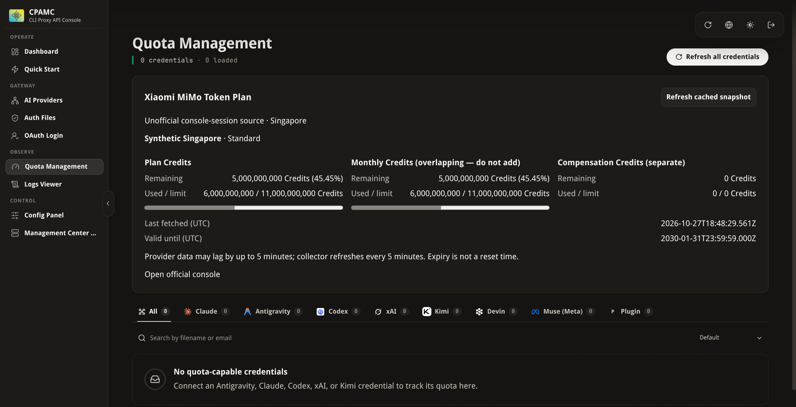

# Verification receipts

## v0.3.1 — 2026-10-29 (branch `feat/v0.3.1-refresher`)

Refresher-only release on top of v0.3.0 (`6eaff9b`). Only what is listed here was run. The automated evidence below was refreshed after the [review round 1 fixes](#review-round-1-fixes).

### Scope

Synthetic local checks, plus one launch check with a throwaway browser profile on the laptop. **No Xiaomi request, real session or cookie, ssh to a real host, collector-host, VM, Docker, production gateway or agents-browser access, and no change to the deployed refresher, its units or its state.** The agents browser (`127.0.0.1:9223`) and the personal browser were never contacted.

### Automated evidence

- Bun **1.3.14** (the pinned `packageManager`, fetched into `/home/tim/cpa-xq-wt/tools/`), `bun test`: **112 pass / 0 fail** across 8 files (30435 `expect()` calls in the final run; the count varies slightly because some tests poll): collector 15, mimo 10, credit 3, renewal-status 5, contract 2, main 1, refresher 56 and native page 20. The new refresher tests are listed below; the contract test is unchanged.
- `bun run type-check` (`tsc --noEmit`): pass. `bun run build`: pass (`main.js` 18.61 KB, unchanged collector).
- Bun **1.4.3** (the laptop's production refresher runtime), `bun test refresher tests/contract.test.ts`: **58 pass / 0 fail**.
- `systemd-analyze --user verify` on a scratch copy of the example service: no findings.
- Go tests and the native integration test were **not** run: `native/` is unchanged since v0.3.0.

New refresher coverage, by test name (synthetic dependencies unless stated):

- **Config:** `XQ_BROWSER_LAUNCH`, `XQ_NOTIFY` and `XQ_TIMER_RUN` parsing; refusal without echo of relative, `~`, control-character and over-long launcher paths and unknown notify modes. The real entrypoint, run with a relative launcher path, a launcher path with a control character and an unknown notify mode, exits 1 with one fixed line that does not contain the value, and creates no run lock (in a scratch `XDG_RUNTIME_DIR`) and no state directory.
- **Launcher runner** (real processes): argv only, closed stdin, allowlisted environment (no `LD_LIBRARY_PATH`, `SSH_AUTH_SOCK` or `XQ_*`), exit codes, kill at the timeout and on abort, and refusal of a symlink, a group- or world-writable file, a non-executable file, a foreign owner, a missing path and a directory.
- **Discovery probe** (real loopback servers): `up` on 200; `unknown` for 404, 500, 302, a response slower than the timeout, an abort and a connection that is accepted and then reset; `refused` only when nothing listens, recognised by both Bun 1.3's `ConnectionRefused` and Bun 1.4's `ECONNREFUSED`. Checked by hand on both versions with a scratch script: a refused loopback port (IPv4, IPv6 and `localhost`) gives exactly these codes, a timeout `TimeoutError` and a reset `ECONNRESET`.
- **Launch:** a stopped browser (port refused) is started, the endpoint polled until it answers, the session read, and the browser closed with `Browser.close` after the owned tab, also after a sign-in failure and over a fresh connection to the same browser id when the first one was lost. If a different browser id answers after the loss, nothing is closed. A running browser whose first probe times out is neither launched over nor closed: the run connects normally and renews, or reports `DevTools endpoint unreachable`. Launcher exit/timeout/unsafe/spawn failure and an endpoint that never answers give the fixed `browser_unavailable` reasons; the wait never outlives the run deadline. Only a browser the run started is closed; without a launcher nothing is probed or started. An interrupt during the wait writes nothing.
- **Early warning:** every branch (running; startable; `--check` failing or unsafe; no launcher; launcher passed but not configured; a port that does not answer in time, without consulting the launcher) with no tab, no cookie and no Xiaomi request, and the exact status written.
- **`--check`:** browser readiness in each variant, the missing-session verdict, `--rebind`, no writes and no state change.
- **Notifications:** enter, repeat (nothing), change, transient failure (nothing), recovery after a renewal and after a healthy run, undelivered then retried, vendor-change and account-mismatch content, disabled mode; fixed wording and markup escaping; the real `notify-send` runner against a stub (argv, allowlisted environment, failure and timeout as `false`).
- **Backoff:** the 15/30/60/60-minute schedule for timer runs with exact backed-off lines and fresh `checkedAt`; bypass for manual runs, `--force`, a changed `rejectedAt` or `updatedAt`, an attempt time in the future and no recorded attempt; `account_mismatch` and vendor change back off, `browser_unavailable`, `vendor_unavailable`, `error`, `not_needed` and `renewed` do not; generic advice without a manual command.
- **Missing session:** `missing` and `invalid_file` (also with `--force` and with a non-auth error) give `account_mismatch` without browser or Xiaomi; `--rebind` renews in `rebind` mode.
- **Vendor change:** loaded console with a missing cookie, and with HTTP 401 or body `code` 403 on validation, report `error (… (vendor change?))`; without a loaded wait the v0.3.0 `signin_required` results are unchanged.
- **Collector unreachable:** each cause (ssh exit 255, timeout, spawn failure, exit 3, unparsable output, sudo patterns, container patterns, other exit codes, oversized output), the same in `--check`; the real runner keeps 4096 bytes of a 1 MB stderr and drains the rest. A fake ssh that exits 255 but leaves a background helper holding stdout and stderr for 8 s returns its exit code and output within 250 ms plus slack (with and without stderr capture), and within its timeout plus 250 ms plus slack when it is killed at the timeout. Against the round-0 runner the same call took 8 s, until the helper exited.
- **State file** (real files): 0700 directory, 0600 file, no temporary leftovers, an existing 0755 directory tightened, twelve corrupt or invalid contents, a symlink and a directory read as empty, an unwritable directory makes `save` return false; through a run, corrupt state causes no backoff and an unwritable one only appends `; state not saved`.
- **Run lock** (real `flock` through `bun:ffi`): a second taker is busy; a holder killed with SIGKILL releases it; the entrypoint prints `busy (another run is in progress)` and exits 1 before any ssh call, while `--check` still runs without the lock.
- **Writer race** (the real `WRITE_SH` under bash against a temporary directory): a stub `stat` renames a same-account session of another size into place exactly when the writer asks for the size; the push installs (exit 0). The same scenario against the v0.3.0 writer (`git show 6eaff9b:refresher/lib.ts`, run by a scratch script) exits 8, so the test detects the old race.
- **Unit:** `TimeoutStartSec` exceeds the 120 s deadline plus tab close, `Browser.close`, final status write and notification by at least 15 s; `StateDirectory`, `StateDirectoryMode=0700`, `NoNewPrivileges` and `Type=oneshot` present; no `--rebind`/`--force` in `ExecStart`.
- **Example launcher** (stub `hyprctl` on `PATH`, no Hyprland): the exact dispatch argument, field codes and whitespace, comment lines ignored, a `[Desktop Action]` Exec (even a fully valid one with `--user-data-dir`) ignored when `[Desktop Entry]` has no Exec (both modes exit non-zero, nothing dispatched), `ok` required, `--check` without dispatch, twenty refused `Exec=` lines (never dispatched, `--check` fails), among them no `--user-data-dir`, a relative, empty or root one, and a relative last one, missing entry, bad arguments, the `~/.local/share` fallback, and running it through the refresher's own launcher runner. Profile in use: a `SingletonLock` naming the test process on this host, another host, an unparsable target or an empty pid gives exit 3 in both modes with no `hyprctl` call; a lock naming a dead pid, or no lock, starts normally; through the launcher runner the start is refused with 3. Syntax checked with `sh -n` and `bash -n`; `dash` was not installed.

### Launch check with a throwaway browser

Run before the review round 1 fixes, when the probe still returned a boolean (`false` below is today's `refused`); the round 1 live check is [below](#review-round-1-fixes). Hyprland **0.56.2** with the Lua config provider. A scratch desktop entry under a scratch `XDG_DATA_HOME` started `google-chrome-stable` with a new profile under the scratch directory and DevTools on `127.0.0.1:9295`; a copy of the example launcher with `id` set to that entry. Two transient `Type=oneshot` user units (`systemd-run --user --wait --collect`) ran scratch scripts that used this branch's `probeBrowser`, `launcherRunner` and `connectBrowser`; no tab was created and nothing was navigated.

1. First unit: probe `false`, `launcher --check` exit 0, launcher start exit 0; the unit ended (`inactive`). Afterwards Chrome was still running, with Hyprland as its parent, in `app.slice/app-com.google.Chrome-<pid>.scope`; its only window was on `special:xiaomi-renewal`; the active window stayed the previously focused application. `Browser.close` over a browser-level connection replied, the endpoint stopped answering within 0.3 s, the process was gone and the special workspace disappeared.
2. Second unit (the refresher's launch path): probe `false`, launcher exit 0, endpoint answering 275 ms later under the 250 ms poll, window on the special workspace without focus, `Browser.close` replied, endpoint gone, no scratch Chrome process left.

The scratch profile was deleted afterwards. The legacy form `hyprctl dispatch exec '[workspace special:… silent] true'` failed on this provider with a Lua syntax error (exit 7).

### Review round 1 fixes

Four review findings were fixed on top of `a35f294`:

1. **A slow running browser was launched over and then closed.** The discovery probe now distinguishes `up`, `refused` (nothing listens) and `unknown` (timeout, other status, other transport error). A renewal launches only on `refused`; on `unknown` it connects normally without treating the browser as its own, and healthy runs and `--check` report `renewal browser not answering`. After a lost connection, `Browser.close` goes only to the same browser id. The example launcher requires `--user-data-dir` and exits 3 while the profile's `SingletonLock` names a live process. That covers a browser that is still starting, whose lock is taken while its port still refuses.
2. **Status-read stderr capture removed the ssh timeout bound** when a descendant kept a pipe open. Both pipes are now cancelled 250 ms after ssh exits or is killed.
3. **deployment.md step 6** said healthy runs and `--check` never touch the browser; it now describes the readiness check and what it cannot catch.
4. **This receipt** claimed entrypoint coverage for the new configuration refusals; the entrypoint test now runs those cases (Config above).

The tests added for 1 and 2 were also run against the round-0 code: a scratch copy of `a35f294`'s `refresher/` with the new test file, Bun 1.3.14. The descendant-pipe, probe and example-launcher tests failed there. With the test doubles' probe switched back to booleans (a timeout as `false`), the late-answering test failed because the run launched, and the swapped-browser case failed because `Browser.close` went to the other browser.

**Live check, round 1.** Hyprland 0.56.2, the same scratch desktop entry and profile directory on `127.0.0.1:9295`, and a copy of the updated example launcher with `id` set to that entry. One transient `systemd-run --user --wait --collect` unit ran a scratch script with this branch's `probeBrowser`, `launcherRunner` and `connectBrowser` on the production refresher runtime 1.4.3. No tab was created and nothing was navigated.

- Before the start the probe was `refused` and `launcher --check` exited 0.
- After the start request, `launcher --check` exited 3 from 213 ms. The probe stayed `refused` until the endpoint answered at 495 ms. A refresher probe in that window sees a refused port, and the launcher is what refuses the second start.
- The `SingletonLock` target had the form `<this host>-<pid>`, and its pid was the browser process reported by `SystemInfo.getProcessInfo`.
- A second start request while the browser ran exited 3. Afterwards there was still exactly one window of that class, on `special:xiaomi-renewal`.
- Two browser-level connections reported the same browser id. `Browser.close` replied, the probe returned `refused` within 0.3 s, the lock was gone, `launcher --check` exited 0 again and no window was left.

The scratch profile was deleted afterwards and no scratch Chrome process remained.

### Review round 2 fixes

Three review findings were fixed on top of `5f41e18`:

1. **Manual retry was backed off.** `timerRun` was derived from `TRIGGER_UNIT` ending in `.timer`. systemd keeps a unit's activation details after its first timer start, so a later manual `systemctl --user start` of the same unit inherits `TRIGGER_UNIT=…​.timer` and was treated as a timer run — the documented manual retry would back off for up to 60 minutes. `timerRun` now comes from `XQ_TIMER_RUN=1`, which only the timer-activated unit sets, and `XQ_MANUAL_COMMAND` is a direct `bun …/refresh-session.ts` run that never carries it. The config test asserts `XQ_TIMER_RUN=1` is a timer run while `"0"`, `"true"`, a stray leading space and a leftover `TRIGGER_UNIT=…​.timer` are not.
2. **Entrypoint wiring was untested.** A new spawn test (`entrypoint: wires state store, launcher and notifier into a full run`) runs the real entrypoint with a scratch `HOME`/`XDG_RUNTIME_DIR`, a fake ssh reporting a healthy collector, a refused CDP port, a stub `XQ_BROWSER_LAUNCH` recording its argv and a stub `notify-send`. It asserts the launcher was called only with `--check`, `state.json` exists at mode 0600 in the 0700 state directory and parses, and that a second run whose `--check` fails ends `browser_unavailable` and sends exactly one notification. Deleting any of the three wiring lines (`launcher`, `notify`, `state`) now fails this test.
3. **`[Desktop Action]` coverage claim.** The example-launcher test only had a `[Desktop Action]` Exec that failed the character filter anyway, so the group restriction was untested. A new case gives the `[Desktop Entry]` group no Exec and the action group a fully valid Exec (`--user-data-dir=/home/user/p`); both modes exit non-zero and nothing is dispatched. verification.md's launcher bullet now claims only this.

Re-run on Bun **1.3.14** (fetched into `/home/tim/cpa-xq-wt/tools/`) under the heavy lock: `bun test` **112 pass / 0 fail** (8 files), `bun run type-check` pass, `bun run build` pass (`main.js` 18.61 KB). Bun **1.4.3** (production refresher runtime), `bun test refresher tests/contract.test.ts`: **58 pass / 0 fail**. No live browser or systemd run was performed in round 2; the real-timer `XQ_TIMER_RUN` inheritance remains [unverified](#unverified) by a live timer.

### Unverified

The refresher entrypoint against a real browser and console (only the library's launch and close steps ran live); a real browser that accepts the DevTools port but answers late (only synthetic servers); a real `notify-send` delivery (only a stub); real ssh, sudo, `docker exec` and a collector host; the installed units, `StateDirectory=` creation by systemd, and the timer-activated unit setting `XQ_TIMER_RUN=1` in a real timer run; whether the console's usage request ever answers HTTP 200 with an authentication failure in the body (see the [vendor-change limitation](session-renewal.md#limitations)).

## v0.3.0 — 2026-10-28 (branch `feat/session-renewal`, code at `cecc085`)

Refreshed after the round-1 review fixes (`93d2fef..cecc085`): account binding for renewals (`account_mismatch`, `--rebind`), no DevTools Network domain, a 100 s run deadline with SIGTERM/SIGINT tab cleanup, a streaming 64 KiB ssh stdout cap, stricter `XQ_REMOTE_DIR` spelling, strict printable-ASCII session files, `nextAttemptAt: null` for missing/unusable files, and the matching page and `quota.fetch` guidance.

### Scope

Synthetic local checks of the integrated branch only. **No live vendor, production gateway, Portainer, collector-host or agents-browser verification is claimed in this section.** No Xiaomi request, real session or cookie, ssh to a real host, Docker change or systemd unit installation was performed.

### Automated evidence

- Bun **1.3.14**: `bun test` **88 pass / 0 fail** across 8 files: collector 15, mimo 10, credit 3, renewal-status 5, contract 2, main 1, refresher 32 and native page 20. Three runs counted 11881, 11878 and 11878 `expect()` calls; the count varies slightly because some tests poll.
- `bun run verify` (tests, `tsc --noEmit`, collector bundle `main.js` 18.61 KB): pass, same 88 / 0.
- Go **1.27.3** linux/amd64 in `native/`: `gofmt -l` clean; `go test -count=1 ./...` pass (13 top-level tests, 25 subtests); `go test -race ./...` pass; `go vet ./...` clean.
- `CGO_ENABLED=1 go build -trimpath -buildvcs=false -buildmode=c-shared` produced a local test library `xiaomi-tokenplan-quota-v0.3.0.so` (SHA-256 `255970cfb179884c899585b1dac7cbf1cc963adb59bdad9d578fca94b54ea352`; local build, not a release artifact).
- `native/integration_test.py` with that library and an unmodified CPA **v8.0.44** (`1f917e7`) binary: pass (`realCABI`, `registeredAndLoaded`, `publicShellOnly`, `unauthenticatedSnapshot` 401, `quotaFraction` 0.4, `authFailureRecovery`, `sessionRenewalPassThrough`, `expiredSessionGuidance`, `accountMismatchGuidance`, `invalidRenewalFailsClosed`, `oldCollectorShape`, `syntheticOnly`). The checks:
  - real C ABI registration; public shell only; unauthenticated snapshot 401; native quota; auth-failure recovery; session/renewal passthrough;
  - expired-session guidance through `quota.fetch` (HTTP 502; message within 400 bytes plus CPA's prefix, naming the renewal host and manual command);
  - **new:** a missing session file with `nextAttemptAt: null` and renewal result `account_mismatch`, which passes through the snapshot route; its `quota.fetch` message names the missing file, the different Xiaomi account, the missing account id and `--rebind` within the same bound;
  - invalid renewal data failing closed (snapshot 503, `quota.fetch` 502) and native quota from the older collector shape.

  Synthetic collector, keys and counters only.

Coverage, by test name:

- **Collector:**
  - atomic session replacement and same-inode rewrite recover without restart;
  - an unchanged rejected session is retried exactly once per auth retry interval;
  - a missing file never reaches Xiaomi and recovers;
  - a missing or unusable file schedules no Xiaomi attempt (`nextAttemptAt: null`);
  - an unusable replacement (invalid UTF-8 or non-printable-ASCII content) stays blocked and watched and is never sent, and `fetchMimoSnapshot` refuses such a Cookie without sending it;
  - non-auth failures do not mark a replaced session rejected;
  - renewal status is validated and re-read every tick;
  - malformed collector environment fails before serving.
- **Renewal status:** parsing enforces the exact schema (including `account_mismatch`), canonical UTC, bounded fields and owner/mode/type/size/UTF-8; every refresher status is accepted verbatim by the collector parser.
- **Refresher:**
  - configuration refusal without echo, including `XQ_REMOTE_DIR` spellings with `.`/`..`, `//` or a trailing `/`; flags limited to `--check`, `--force` and `--rebind`;
  - remote command quoting through a POSIX login shell;
  - the remote writer run locally against temporary directories: atomic owner-only replace; refusal of missing, symlinked, group/world-accessible or symlink-suffixed (`link/`, `link/.`) directories; `push` only over a session with the same single `userId`, `rebind` without that check; new lines limited to 1–16384 printable ASCII bytes with one `userId`;
  - account binding end to end: same account renews; another account is `account_mismatch`, exit 3, with the file untouched; `--rebind` switches;
  - cookie only on stdin with a minimal environment; ssh killed as soon as stdout passes 64 KiB;
  - v0.3/v0.2 status shapes; exact cookie selection; validation headers, redirect refusal and 401/403 mapping;
  - heartbeat, `--check`, sign-in page, SSO pass-through; foreign targets, subframes and network events ignored; readiness expression boolean-only and same-origin;
  - every failure branch writes its status and closes the owned target; the run deadline bounds every step and records `run deadline exceeded`; SIGTERM/SIGINT close the owned target at once, write nothing and make the entrypoint exit 128+signal;
  - loopback-only DevTools discovery; end to end over a synthetic DevTools socket.
- **Native page:** healthy summary (including the no-agent single-file-mount caveat and early `account_mismatch`/sign-in warnings), every rejected-session renewal state (including `account_mismatch` and the stale-agent ssh/sudo/Docker cause), manual command as code text, file problems with no Xiaomi contact while missing/unusable, legacy collectors, vendor/stale/subscription guidance, snapshot failures, cleanup on disconnect, no HTML sinks, relative times.
- **Go:** strict session/renewal validation (including `account_mismatch`), passthrough, and specific bounded `quota.fetch` messages without leaking collector errors. These cover `account_mismatch`, a stale agent, `not_needed` after a rejection, and a next attempt omitted when `null` or due.

### Synthetic DevTools observation

Throwaway headless Chrome **156.0.8078.73** with a temporary profile, an OS-assigned loopback DevTools port and `--host-resolver-rules` mapping `platform.xiaomimimo.com` and `account.xiaomi.com` to a local self-signed TLS server; every other host was unresolvable. No Xiaomi contact and no agents browser. The probe drove the branch's real `connectBrowser` and `readBrowserSession` and recorded every DevTools event and command. It is an ad hoc probe, not in the repository; it printed cookie names and event method names only, never values.

| Scenario | Result | DevTools traffic |
| --- | --- | --- |
| Signed in (synthetic `passToken` seeded), SSO via server-side redirects | Exactly the four cookie names, in order | Commands: `Target.createTarget`, `Target.attachToTarget`, `Page.enable`, `Page.navigate`, `Runtime.evaluate`, `Network.getCookies`, `Target.closeTarget`. Zero `Network.*` events; no `passToken`, platform cookie value, `Set-Cookie` or callback ticket in any event |
| Signed out | `signin_required` after the 8 s grace, tab closed | Same event types, zero `Network.*` events |
| Signed in, account page forwarding to the callback by script | Renewed as above | Zero `Network.*` events and no cookie value in any event. The callback URL's synthetic one-time ticket appeared in `Page.frameRequestedNavigation`, `Page.frameScheduledNavigation` and `Page.frameStartedNavigating` |

This is the residual the [security model](session-renewal.md#security-model) states: Page events can carry navigation URLs with their queries, but no cookie or header values. The refresher reads only the main-frame hostname from `Page.frameNavigated`. The round-1 fix verification of refresher commit `db59eda` reported the same findings with Chrome 156: zero `Network.*` events, `passToken` in no event, and the callback ticket visible in Page events.

### Interrupt against a real browser

The real entrypoint `refresher/refresh-session.ts` (Bun 1.3.14) ran against the same kind of throwaway Chrome, with the fake hosts never answering. A stub `ssh` on `PATH` reported a rejected session and recorded write calls; no real ssh was used. SIGTERM and SIGINT were sent while the owned console tab was open. Each run printed `xiaomi-session-refresh: interrupted` on stderr and exited 143 and 130 respectively, within 0.3 s. Each time the owned tab was gone afterwards (page targets back to the one pre-existing tab), and no status or session write was attempted.

### Manual fallback snippet

The guarded block in [manual fallback](session-renewal.md#manual-fallback) was run in bash 5.3 and zsh 5.9 against a temporary directory holding a synthetic session. An empty line and EOF each printed `not installed` and left the old file (mode 0600) and no temporary file. A synthetic value was installed with mode 0600. With the block and the value fed as one script on stdin, simulating a paste without bracketed paste, the line after the block was read as the value, not a line of the block.

### Unverified

Real Chrome against the Xiaomi console, the real SSO page's forwarding method, cookie re-minting and the about-24 h lifetime (observations only); real ssh, sudo and `docker exec` on a collector host; the systemd units (installation, and SIGTERM delivery by the 150 s start timeout; the signal path itself is covered above); the compose proposal (not rendered or started in this pass); image digests; production network/auth boundaries and live acceptance.

## Earlier receipt — 2026-10-27 (collector and legacy v0.1.0 panel)

### Scope

Implementation and public publication approved. No live installation, cookie extraction/provisioning/replay, vendor calls, inference or billing change performed by the implementation. Discovery was a separate, earlier explicitly approved read-only action; see [discovery](discovery.md).

### Automated evidence

- Bun **1.3.14**, locked dev dependencies: core **17 tests pass**, TypeScript `tsc --noEmit` pass, collector bundle pass.
- Tests observed RED before initial parser/collector/panel implementations. An independent reviewer identified a P1 risk, reproduced by the implementation regression: ordinary JSON decoding could round a fractional raw numeric Credit into a safe integer before validation. A raw-body fetch regression was observed failing, then fixed with Bun's original numeric-token source context. Fractional/exponential numeric counter tokens fail closed; decimal strings retain exact precision.
- Additional RED→GREEN regression prevents prototype-key plan metadata from escaping the tier allowlist.
- Pinned panel fresh clone: baseline **1656 pass / 0 fail**; patched **1662 pass / 0 fail**. Focused Xiaomi **6 pass**. Clean and patched lint, type-check and production single-file build pass.
- Original research checkout had **1655 pass / 1 inherited fail**: `cooldown section rendering > keeps the reset action contextual and exposes pending state`, `tests/authFileCooldowns.test.ts:228`; literal apostrophe expectation versus HTML-escaped apostrophe. The operator chose no upstream fix. Its result is environment/order-sensitive; the builder records the actual clean baseline and rejects added failures. No test or hook is bypassed.
- Parser checks: named/reordered/duplicate/missing pools; overlapping monthly/plan semantics; zero/over-limit/fractional/huge Credits; original raw JSON numeric tokens; UTC expiry validation; unknown tier; business/HTTP auth errors, HTML, malformed/oversized bodies, redirects and deadline/transport failures.
- Collector checks: process-owned regular secret file; permission/symlink/missing/empty rejection; no secret/error leakage; concurrent cached readers; stale-success preservation; auth retry halt; shutdown abort; method/query/path denial.
- The unapplied compose proposal passes local `compose config --quiet` with synthetic required variables; no container was built or started. Active TypeScript diagnostics found no errors. A generic AST rule flags `new URL(request.url)` as potentially throwing; the handler receives a platform-created `Request` with a valid absolute URL, not a raw caller string. That advisory is not a compiler error.
- Independent read-only review found no remaining issues after the two regressions were fixed. The reviewer inspected source and existing logs, but did not independently execute commands or live checks.
- Panel checks: exact Singapore config-backed source with no auth file; no credential fields in fixed management transport; strict sanitized contract and independent balance validation; real card rendering; page mounts card while OAuth files are empty; unconfigured/auth/unavailable/stale/expired/exhausted states. Server rendering substitutes only Vite CSS Module loading, not application components.

### Browser proof (synthetic only)

Served the **built management.html** on a task-owned ephemeral loopback server, with a synthetic management backend and fake preview-only key. Used an owned tab in the approved Agents browser; no live CPA or vendor requests.

- Actual quota route rendered Xiaomi plan/monthly/compensation Credits despite **zero OAuth credentials**.
- Remaining **5,000,000,000 Credits (45.45%)** matched the synthetic fixture, with explicit Singapore/account/source/UTC validity labels and no clipping at the tested desktop viewport.
- Changed the fake backend to auth-required/stale; clicked the real Refresh cached snapshot button. Session-required and stale warnings appeared while the last known balance was preserved.
- Clicked real Logout; prior quota and account disappeared.
- Closed the exact owned tab/session and task-owned server; the original seven browser pages remained. A first preview-port collision was detected; no service was changed, and the verified preview used an OS-allocated free port.

### Unverified / deployment gates

Production network/auth boundaries, independent cookie recipe/replay/lifecycle, account-to-CPA-key binding, regional entitlement, same-time live accuracy, production image digests, restart and rollback. No browser layout claim for mobile or all languages; all six locale files are populated, but human translation review remains useful. Source/release provenance and final checksums are emitted by the builder; see the release manifest, not a guessed latest version.
